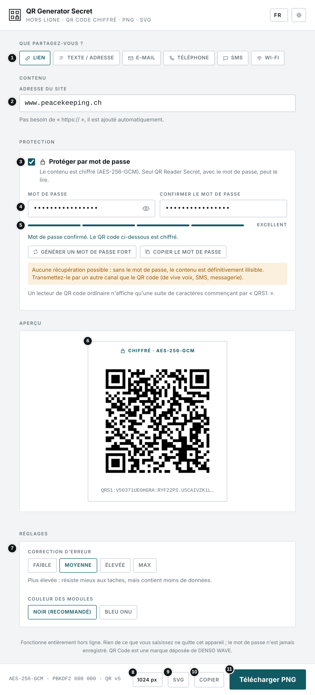
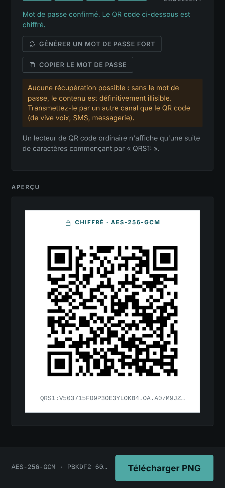
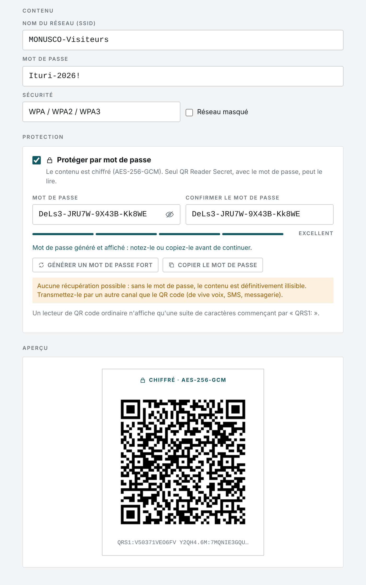
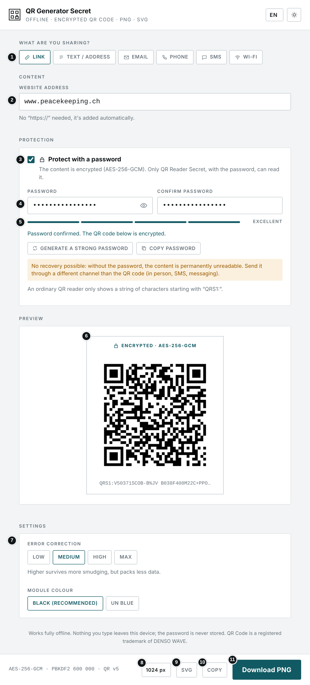
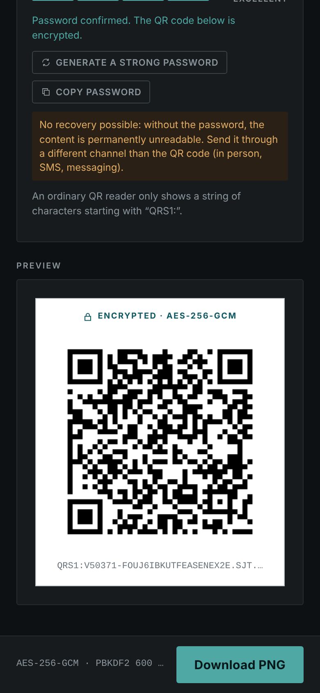
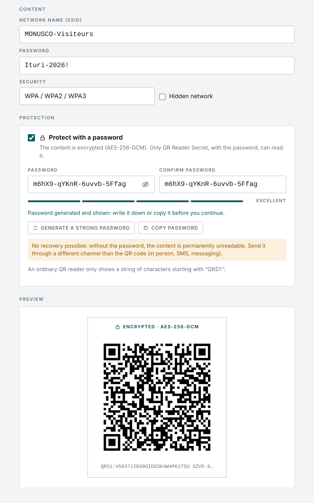

# QR Generator Secret

**`QR_GENERATOR_SECRET.html`** · Hors ligne · Aucune installation · Aucun envoi · Chiffrement par mot de passe — *Offline · No install · No upload · Password encryption*

**[Français](#français) · [English](#english)**

📘 Manuel d'utilisation / User manual (FR) : [PDF](Manuel_QR_GENERATOR_SECRET.pdf) · [Word](Manuel_QR_GENERATOR_SECRET.docx)

---

## Français

### À quoi sert cet outil

Cet outil crée un QR code à partir d'un lien, d'un texte, d'une adresse e-mail, d'un numéro de téléphone, d'un SMS ou des identifiants d'un réseau Wi-Fi, puis l'exporte en image PNG ou SVG. Il peut en plus **protéger le contenu par un mot de passe** : les données sont chiffrées avant d'être placées dans le QR code, et seul [QR Reader Secret](https://github.com/FOSS4DF/QR_READER_SECRET), avec le bon mot de passe, peut les lire.

### Avant de commencer

- Ouvrez le fichier QR_GENERATOR_SECRET.html par double-clic : il s'affiche dans votre navigateur (Chrome, Edge, Firefox ou Safari récents). Aucune installation n'est nécessaire.
- L'outil fonctionne sans connexion Internet. Aucun fichier n'est envoyé : tout le traitement, chiffrement compris, se fait sur votre appareil.
- La langue (FR, EN, SW, LN) se choisit en haut à droite ; le bouton voisin bascule entre thème clair et sombre. Ces choix sont mémorisés. Le mot de passe, lui, n'est jamais enregistré.
- Sans la case « Protéger par mot de passe », l'outil fonctionne exactement comme QR Generator.

### L'écran en un coup d'œil



1. Type de contenu
2. Champ de saisie (il change selon le type)
3. Protéger par mot de passe (active le chiffrement)
4. Mot de passe et confirmation ; l'œil affiche ou masque la saisie
5. Robustesse du mot de passe, générateur de mot de passe fort et copie
6. Aperçu du QR code chiffré (mention « Chiffré · AES-256-GCM »)
7. Réglages : correction d'erreur et couleur
8. Taille du PNG (512, 1024 ou 2048 px)
9. Télécharger en SVG (vectoriel, pour l'impression)
10. Copier l'image dans le presse-papiers
11. Télécharger PNG

#### Sur téléphone (thème sombre)



### Utilisation pas à pas

1. Choisissez ce que vous partagez : Lien, Texte / adresse, E-mail, Téléphone, SMS ou Wi-Fi.
2. Remplissez les champs. L'aperçu se met à jour pendant la saisie.
3. Cochez « Protéger par mot de passe », puis saisissez le mot de passe deux fois, ou cliquez sur « Générer un mot de passe fort » et copiez-le. Le QR code n'apparaît que lorsque les deux saisies sont identiques (8 caractères minimum).
4. Vérifiez la mention « Chiffré · AES-256-GCM » au-dessus du QR code : le texte en dessous commence alors par « QRS1: ».
5. Ajustez si besoin la correction d'erreur (« Moyenne » convient dans la plupart des cas ; « Élevée » ou « Max » pour un affichage extérieur exposé) et la couleur.
6. Téléchargez en PNG après avoir choisi la taille, en SVG, ou copiez l'image. Un QR code chiffré est enregistré sous le nom « qr-secret » pour que le nom du fichier ne révèle rien du contenu.
7. Transmettez le mot de passe par un autre canal, et testez toujours le QR code avec QR Reader Secret avant de l'imprimer ou de le diffuser.

#### Effet du scan selon le type

| Type | Ce qui se passe au scan |
|---|---|
| **Lien** | Ouvre le site. « https:// » est ajouté automatiquement. |
| **Texte / adresse** | Affiche le texte. |
| **E-mail** | Ouvre un nouveau message prérempli (destinataire, objet, message). |
| **Téléphone** | Ouvre le composeur avec le numéro prêt à appeler. |
| **SMS** | Prépare un SMS avec le numéro et le message. |
| **Wi-Fi** | Connecte le téléphone au réseau (nom, mot de passe, sécurité). |
| **Tout type, protégé** | Une application ordinaire n'affiche qu'un texte illisible commençant par « QRS1: ». QR Reader Secret demande le mot de passe, puis affiche la fiche du type d'origine. |

### Protection par mot de passe

| Élément | Détail |
|---|---|
| **Algorithme** | AES-256-GCM : chiffrement authentifié, toute modification du QR code est détectée. |
| **Clé** | Dérivée du mot de passe par PBKDF2-HMAC-SHA256, 600 000 itérations, sel aléatoire de 16 octets. |
| **Aléa** | Vecteur d'initialisation (IV) aléatoire de 12 octets à chaque QR code : le même contenu donne un QR code différent à chaque fois. |
| **Codage** | Base45 (RFC 9285), adapté au mode alphanumérique des QR codes. |
| **Taille** | Le chiffrement ajoute l'équivalent d'environ 55 octets : le QR code est un peu plus dense (un lien court passe par exemple de la version 3 à la version 5). |
| **Mise en œuvre** | API Web Crypto du navigateur, aucune bibliothèque supplémentaire. |
| **Mot de passe** | Jamais enregistré ni transmis. Normalisé (Unicode NFC) pour que les lettres accentuées saisies sur différents appareils correspondent. |

### Résultat



*Exemple Wi-Fi protégé : mot de passe généré, QR code chiffré prêt à télécharger.*

### Bonnes pratiques

- Ne transmettez jamais le mot de passe avec le QR code (même affiche, même message, même e-mail) : utilisez un autre canal.
- Choisissez au moins 12 caractères variés, ou utilisez le générateur. Un QR code diffusé peut être photographié et attaqué hors ligne sans limite d'essais : la robustesse du mot de passe est la seule protection.
- Aucune récupération n'est possible en cas d'oubli : conservez le mot de passe dans un gestionnaire de mots de passe.
- Préférez le noir sur fond blanc et conservez la marge blanche autour du code. Un QR code chiffré est plus dense : imprimez-le à au moins 3 × 3 cm, plus grand pour une lecture à distance.
- Choisissez le SVG pour l'impression grand format et le PNG 2048 px pour les documents.
- Plus le contenu est long, plus le code est dense : raccourcissez-le si possible.

### En cas de problème

| Problème | Solution |
|---|---|
| **Aucun QR code n'apparaît avec la protection** | Les deux mots de passe doivent être identiques et compter au moins 8 caractères. |
| **« Trop de données pour un seul QR code »** | Raccourcissez le contenu ou baissez la correction d'erreur. Le chiffrement ajoute l'équivalent d'environ 55 octets. |
| **« Le chiffrement n'est pas disponible… »** | Navigateur trop ancien, ou page ouverte en http : ouvrez le fichier directement (double-clic) ou via https. |
| **Un téléphone affiche « QRS1:… »** | C'est normal : le contenu est chiffré. Ouvrez l'image avec QR Reader Secret. |
| **Le bouton « Copier » ne fonctionne pas** | Le navigateur ne le permet pas : utilisez le téléchargement. |
| **Le QR code ne se lit pas** | Vérifiez le contraste (noir recommandé), la taille d'impression et la marge blanche. |

### Confidentialité

L'outil fonctionne entièrement sur votre appareil, sans connexion Internet. Aucune donnée n'est transmise ni conservée en dehors des fichiers que vous téléchargez vous-même. Le mot de passe et la clé dérivée restent en mémoire le temps de la session et ne sont jamais enregistrés.

### Spécification technique (format QRS1)

```
QR code (mode alphanumérique) = "QRS1:" + Base45( en-tête ‖ sel ‖ IV ‖ chiffré ‖ tag )
  en-tête   5 o  : version (0x01) ‖ itérations PBKDF2 (uint32, big-endian)
  sel      16 o  : aléatoire
  IV       12 o  : aléatoire
  chiffré   n o  : AES-256-GCM du contenu encodé en UTF-8
  tag      16 o  : tag d'authentification GCM (128 bits)
  clé      = PBKDF2-HMAC-SHA256( NFC(mot de passe), sel, itérations ) → 256 bits
  AAD      = "QRS1" ‖ en-tête
```

Le format est public : n'importe quel outil qui l'implémente peut lire ces QR codes avec le mot de passe. Le lecteur refuse une version inconnue et un nombre d'itérations hors de l'intervalle 10 000 – 2 000 000.

---

## English

### What this tool is for

This tool creates a QR code from a link, text, e-mail address, phone number, text message or Wi-Fi credentials, and exports it as a PNG or SVG image. It can also **protect the content with a password**: the data is encrypted before it goes into the QR code, and only [QR Reader Secret](https://github.com/FOSS4DF/QR_READER_SECRET), with the right password, can read it.

### Before you start

- Double-click QR_GENERATOR_SECRET.html: it opens in your browser (recent Chrome, Edge, Firefox or Safari). Nothing to install.
- The tool works without an Internet connection. No file is uploaded: everything, including encryption, is processed on your device.
- Choose the language (FR, EN, SW, LN) at the top right; the button next to it switches between light and dark theme. Both choices are remembered. The password never is.
- With “Protect with a password” unticked, the tool works exactly like QR Generator.

### The screen at a glance



1. Content type
2. Input field (changes with the type)
3. Protect with a password (turns encryption on)
4. Password and confirmation; the eye shows or hides what you type
5. Password strength, strong password generator and copy
6. Encrypted QR code preview (“Encrypted · AES-256-GCM” label)
7. Settings: error correction and colour
8. PNG size (512, 1024 or 2048 px)
9. Download as SVG (vector, for print)
10. Copy the image to the clipboard
11. Download PNG

#### On a phone (dark theme)



### Step by step

1. Choose what you are sharing: Link, Text / address, Email, Phone, SMS or Wi-Fi.
2. Fill in the fields. The preview updates as you type.
3. Tick “Protect with a password”, then type the password twice, or click “Generate a strong password” and copy it. The QR code only appears once both entries match (at least 8 characters).
4. Check the “Encrypted · AES-256-GCM” label above the QR code: the text below it now starts with “QRS1:”.
5. If needed, adjust the error correction (“Medium” suits most cases; “High” or “Max” for exposed outdoor display) and the colour.
6. Download as PNG after choosing the size, as SVG, or copy the image. An encrypted QR code is saved as “qr-secret” so the file name reveals nothing about the content.
7. Send the password through a different channel, and always test the QR code with QR Reader Secret before printing or sharing it.

#### What scanning does, by type

| Type | What happens on scan |
|---|---|
| **Link** | Opens the website. “https://” is added automatically. |
| **Text / address** | Shows the text. |
| **Email** | Opens a pre-filled new message (recipient, subject, message). |
| **Phone** | Opens the dialler with the number ready to call. |
| **SMS** | Prepares a text message with the number and message. |
| **Wi-Fi** | Connects the phone to the network (name, password, security). |
| **Any type, protected** | An ordinary app only shows unreadable text starting with “QRS1:”. QR Reader Secret asks for the password, then shows the card for the original type. |

### Password protection

| Item | Detail |
|---|---|
| **Algorithm** | AES-256-GCM: authenticated encryption, any change to the QR code is detected. |
| **Key** | Derived from the password with PBKDF2-HMAC-SHA256, 600,000 iterations, random 16-byte salt. |
| **Randomness** | Random 12-byte initialisation vector (IV) for every QR code: the same content gives a different QR code each time. |
| **Encoding** | Base45 (RFC 9285), suited to the QR code alphanumeric mode. |
| **Size** | Encryption adds the equivalent of about 55 bytes: the QR code is slightly denser (a short link goes, for example, from version 3 to version 5). |
| **Implementation** | The browser's Web Crypto API, no extra library. |
| **Password** | Never stored or sent. Normalised (Unicode NFC) so accented letters typed on different devices match. |

### Result



*Protected Wi-Fi example: generated password, encrypted QR code ready to download.*

### Good practice

- Never send the password together with the QR code (same poster, same message, same e-mail): use a different channel.
- Use at least 12 varied characters, or the generator. A shared QR code can be photographed and attacked offline with unlimited guesses: password strength is the only protection.
- There is no recovery if the password is forgotten: keep it in a password manager.
- Prefer black on white and keep the white margin around the code. An encrypted QR code is denser: print it at least 3 × 3 cm, larger for scanning from a distance.
- Use SVG for large-format printing and PNG 2048 px for documents.
- The longer the content, the denser the code: shorten it when possible.

### Troubleshooting

| Problem | Solution |
|---|---|
| **No QR code appears with protection on** | Both passwords must match and be at least 8 characters long. |
| **“Too much to fit in one QR code”** | Shorten the content or lower the error correction. Encryption adds the equivalent of about 55 bytes. |
| **“Encryption isn't available…”** | Outdated browser, or page opened over http: open the file directly (double-click) or over https. |
| **A phone shows “QRS1:…”** | That's expected: the content is encrypted. Open the image with QR Reader Secret. |
| **“Copy” does not work** | The browser does not allow it: use Download instead. |
| **The QR code does not scan** | Check contrast (black recommended), print size and the white margin. |

### Privacy

The tool runs entirely on your device, without an Internet connection. No data is sent or kept anywhere other than the files you download yourself. The password and derived key stay in memory for the session only and are never stored.

### Technical specification (QRS1 format)

```
QR code (alphanumeric mode) = "QRS1:" + Base45( header ‖ salt ‖ IV ‖ ciphertext ‖ tag )
  header     5 B : version (0x01) ‖ PBKDF2 iterations (uint32, big-endian)
  salt      16 B : random
  IV        12 B : random
  ciphertext n B : AES-256-GCM of the UTF-8 content
  tag       16 B : GCM authentication tag (128 bits)
  key       = PBKDF2-HMAC-SHA256( NFC(password), salt, iterations ) → 256 bits
  AAD       = "QRS1" ‖ header
```

The format is public: any tool that implements it can read these QR codes with the password. The reader rejects an unknown version and an iteration count outside 10,000 – 2,000,000.

---

*Bibliothèque intégrée / Embedded library: qrcode-generator (Kazuhiko Arase, MIT). Chiffrement / Encryption: Web Crypto API.*
